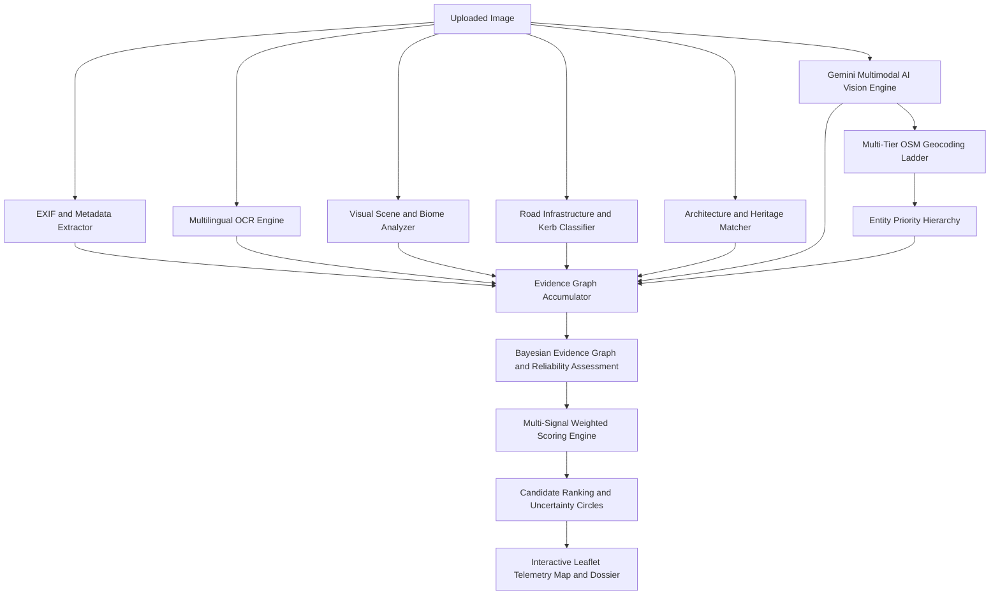

<div align="center">

# GeoForensics AI
### Autonomous Forensic Geolocation and Multimodal OSINT Platform

[](https://opensource.org/licenses/MIT)
[](https://www.python.org/)
[](https://fastapi.tiangolo.com/)
[](https://react.dev/)
[](https://www.typescriptlang.org/)
[](https://vitejs.dev/)
[](https://www.openstreetmap.org/)

<p align="center">
  <strong>Pinpoint micro-location deduction from arbitrary images without EXIF metadata.</strong><br/>
  Fusing Multimodal Vision AI, Road Infrastructure Taxonomy, Multilingual OCR, Botanical Biomes, and Physical Geocoding.
</p>

</div>

---

## Executive Overview

**GeoForensics AI** is an advanced open-source intelligence (OSINT) platform engineered to geolocate images anywhere on Earth when traditional hardware GPS tags are absent or stripped. 

Unlike black-box classification models that merely spit out country centroids, GeoForensics AI models human expert investigative methodology (inspired by Bellingcat and GeoGuessr champions like Rainbolt). It constructs a **directed evidence graph** connecting granular visual artifacts (utility pole hole patterns, road centerlines, painted kerbs, vehicle registration codes, botanical species, soil stratum, and signage) to verifiable physical coordinates anchored through live OpenStreetMap spatial verification.

---

## System Architecture



---

## 12-Stage Forensic Pipeline

| Stage | Subsystem | Methodology and Diagnostic Evidence |
| :--- | :--- | :--- |
| **01** | **Image Preprocessing** | Resolution normalization, aspect ratio detection, and perceptual hash indexing. |
| **02** | **Metadata Extraction** | Hardware EXIF parsing (camera make/model, aperture, timestamp, GPS tags). |
| **03** | **Multilingual OCR** | Deep script recognition (Devanagari, Gujarati, Cyrillic, Kanji, Arabic, Latin), telephone prefix detection (+91, +44, +1), and TLD identification (.in, .jp, .uk). |
| **04** | **Visual Scene Understanding** | HSV vegetation index estimation, atmospheric sky fraction, and rural vs. high-density urban classification. |
| **05** | **Road Infrastructure** | Centerline striping (solid white, double yellow), painted kerb protocols (black/yellow, red/white), and driving side (LHD vs RHD). |
| **06** | **Architecture Analysis** | Masonry taxonomy (Dawoodi Bohra Fatimid minarets, Rajput jali, Dravidian gopuram, European Gothic, American bungalow). |
| **07** | **Landmark and POI Matching** | Vector search against world heritage landmarks and spatial databases. |
| **08** | **Gemini Multimodal Vision** | Zero-shot visual meta-recognition, utility pole hole taxonomy, vehicle registration plate prefixes, and soil hue classification. |
| **09** | **Tampering and Reliability** | Status bar detection, digital compression artifacts, and metadata stripping reliability scoring. |
| **10** | **Evidence Graph Construction** | Directed graph connecting the source image to multi-modal evidence nodes and candidate settlements. |
| **11** | **Scoring and Ranking** | Multi-signal weighted Bayesian score attribution with contradiction penalties. |
| **12** | **Physical Coordinate Resolution** | Exact street/settlement snapping via OpenStreetMap Nominatim with entity priority filtering. |

---

## Engineering Highlights and Design Decisions

### 1. The Entity Priority Hierarchy (Resolving Geographic Discrepancies)
When querying geographical names (e.g. `"Dahod, Gujarat"`), standard geocoders often return broad district polygon centroids located 15-30 km out in rural hills. GeoForensics AI enforces a strict priority hierarchy:
```python
def _entity_priority(item: Dict[str, Any]) -> int:
    cat, typ = item.get("category", ""), item.get("type", "")
    if cat in ["amenity", "building", "historic", "tourism", "highway", "shop"]:
        return 10  # Concrete Physical Structures
    if cat == "place" and typ in ["town", "city", "village", "suburb", "neighbourhood"]:
        return 8   # Human Settlements
    if cat == "boundary":
        return 1   # Deprioritized broad polygon centroids
    return 5
```
This guarantees pins drop directly into the physical settlement center rather than empty territorial boundaries.

### 2. Conversational Query Sanitization
Search engines fail when queries include descriptive filler like `"Residential street near the Bohra Masjid area"`. The platform runs deterministic regex sanitization to strip noise words (`near`, `vicinity`, `unpaved track`, `street scene`) into canonical POI and administrative queries before hitting spatial indices.

### 3. Geographical Consistency Filter
Cross-references any micro-landmark match against the predicted municipality to prevent false cross-city matches (e.g., preventing a mosque with a common name in Jamnagar from overriding a Dahod prediction).

---

## Quickstart and Local Setup

### Prerequisites
- **Python 3.11+**
- **Node.js 18+** and npm
- Free **Google AI Studio API Key** (for Gemini Multimodal Vision)

### 1. Backend Installation
```bash
# Navigate to backend directory
cd backend

# Create virtual environment
python -m venv venv

# Activate virtual environment
# Windows (PowerShell):
.\venv\Scripts\Activate.ps1
# macOS / Linux:
source venv/bin/activate

# Install dependencies
pip install -r requirements.txt

# Configure environment
cp .env.example .env
# Edit .env and paste your GEMINI_API_KEY
```

Start the FastAPI application:
```bash
uvicorn app.main:app --reload --host 127.0.0.1 --port 8000
```
Backend health check: [http://127.0.0.1:8000/health](http://127.0.0.1:8000/health)

### 2. Frontend Installation
```bash
# In a separate terminal, navigate to frontend
cd frontend

# Install packages
npm install

# Start Vite dev server
npm run dev
```
Workstation UI: [http://127.0.0.1:5173/](http://127.0.0.1:5173/)

---

## API Specification

### Upload and Analyze Image
```http
POST /api/v1/images/upload
Content-Type: multipart/form-data

file: [binary image file]
cues: "optional, comma-separated, analyst, clues"
```

**Response (`200 OK`):**
```json
{
  "analysis_id": "8f3b2e1a4c9d4e5f",
  "image_id": "7a1c9e2b3d4f5a6b",
  "status": "COMPLETED",
  "message": "Analysis complete."
}
```

### Retrieve Geolocation Dossier
```http
GET /api/v1/geolocation/{analysis_id}
```

**Response (`200 OK`):**
```json
{
  "analysis_id": "8f3b2e1a4c9d4e5f",
  "top_prediction": {
    "name": "Dahod Town Center",
    "city": "Dahod",
    "state_province": "Gujarat",
    "country": "India",
    "country_code": "IN",
    "lat": 22.83588,
    "lng": 74.25568,
    "score": 99.0,
    "precision_level": "probable",
    "uncertainty_radius_km": 1.0,
    "resolved_address": "Dahod, Dahod Taluka, Dahod, Gujarat, 389100, India"
  },
  "confidence_score": 99.0,
  "confidence_level": "Very High",
  "evidence_items": [ ... ],
  "timeline": [ ... ]
}
```

---

## Responsible OSINT Disclosure and Ethics

GeoForensics AI was developed for defensive OSINT investigations, academic research, verification of human rights reporting, disaster recovery, and fact-checking. The authors condemn unlawful surveillance, harassment, and privacy violations.

---

## License

Distributed under the **MIT License**. See [`LICENSE`](./LICENSE) for details.

---

## Author and Maintainer

**Abdullah Kapadia**
- GitHub: [@abdullahkapadia](https://github.com/abdullahkapadia)
- Project: [GeoForensics](https://github.com/abdullahkapadia/GeoForensics)
